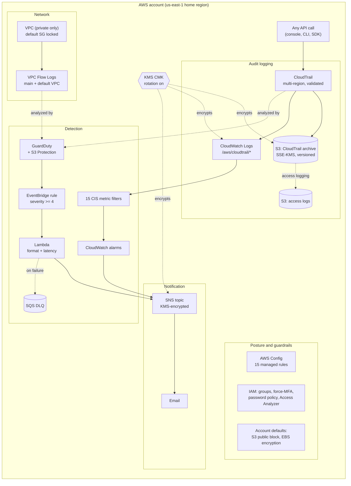

# Architecture

## Module map

| Module | What it creates | Why it exists |
|---|---|---|
| `bootstrap/` | Remote-state S3 bucket, monthly budget | State holds every resource ID and can hold secrets; it must be encrypted, versioned, and off the laptop. The budget turns runaway cost into an email. |
| `kms` | One customer-managed key with rotation | Gives us a key policy to control who can decrypt audit logs and lets CloudWatch alarms publish to an encrypted topic. |
| `cloudtrail` | Multi-region trail, archive bucket, access-log bucket, CloudWatch Logs stream | The audit record every investigation starts from. |
| `monitoring` | 15 metric filters and alarms on the CloudTrail stream | Real-time alerts on root use, IAM/policy changes, disabled logging, network changes, failed logins. |
| `guardduty` | Detector with S3 Protection | Managed threat detection over CloudTrail, flow logs, and DNS. |
| `alerting` | EventBridge rule, Lambda, SNS topic, DLQ | Turns findings into readable alerts within minutes. |
| `network` | Private VPC, locked default SGs, flow logs on every VPC | Network visibility and a fail-closed default. |
| `config` | Recorder, delivery bucket, 15 managed rules | Continuous compliance: drift shows up as NON_COMPLIANT. |
| `iam` | Force-MFA policy, admin/auditor/provisioner groups, support role | Least privilege through groups; MFA for humans. |
| `account-hardening` | Password policy, Access Analyzer, EBS default encryption, account S3 public access block | One-time switches that protect every future resource. |
